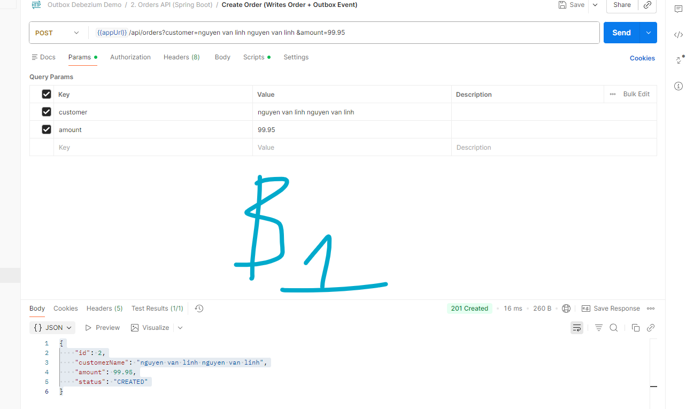
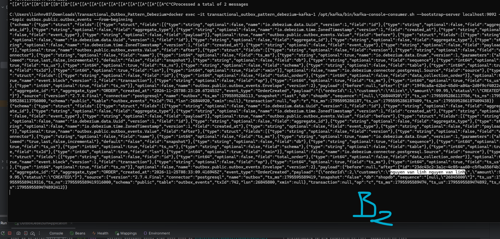

# Transactional Outbox Pattern & Debezium

## 1. What is the Transactional Outbox Pattern?

Imagine you save a new `Order` in your database and then try to send an `"OrderCreated"` message to Kafka so the `Payment` or `Shipping` service knows about it.

If you do those two steps separately, something can go wrong in the middle:

* The database saves the order, **but Kafka is down** -> the message is lost, and other services never know an order was placed!

* Or the message goes out, **but the database rolls back** -> other services act on an order that doesn't exist.

The **Transactional Outbox Pattern** fixes this by saving:

1. Your real business data (`orders`), **AND**

2. A row in an `outbox_events` table

inside **one single database transaction**. Either **both** are saved together, or **neither** is saved.

## 2. What is Debezium?

**Debezium** is an open-source **Change Data Capture (CDC)** tool. Think of it like a watcher that reads your database's transaction log (such as PostgreSQL's `WAL`) and spots every new row that gets committed.

When a new row is added to `outbox_events`, Debezium sees it in the database log and forwards that event to **Kafka** (or another message system).

## 3. Why do we need both together?

* **Transactional Outbox** guarantees **no lost or mismatched data** between your database save and your event record.

* **Debezium** handles **delivering those outbox rows reliably** to Kafka without your Java service having to write and maintain a polling timer loop.

Together, you get **safe database commits** plus **fast, automatic event delivery** to other services.

## 4. Who controls what?

* **Your Spring Boot app controls:** Saving the `Order` and the `OutboxEvent` together in one database transaction (`@Transactional`).
* **PostgreSQL controls:** Saving the committed data safely and recording it in the database log (`WAL`).
* **Debezium controls:** Reading that log and sending the event to Kafka for you.

# Transactional Outbox Pattern — Verification Guide
### 3. Consume Messages from the Topic

```cmd
docker exec -it transactional_outbox_pattern_debezium-kafka-1 /opt/kafka/bin/kafka-console-consumer.sh --bootstrap-server localhost:9092 --topic outbox.public.outbox_events --from-beginning
```

### Verification Evidence

#### Step 1


#### Step 2

